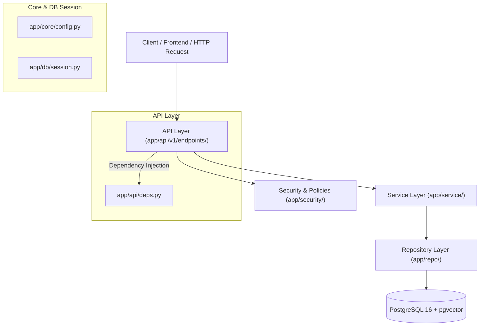

# Helpdesk AI - Backend Service

Dịch vụ Backend cho hệ thống **Helpdesk AI**, được xây dựng bằng **FastAPI**, **PostgreSQL (pgvector)**, **SQLAlchemy 2.0 (Async)** và **Pydantic v2**. 

Dự án được tổ chức theo kiến trúc phân tầng chuyên biệt (**3-Tier Architecture**: *Endpoints - Services - Repositories*) nhằm đảm bảo phân tách rõ ràng trách nhiệm, dễ bảo trì, dễ mở rộng và kiểm thử tự động toàn diện.

---

## 1. Kiến trúc phân tầng (3-Tier Architecture)



### Nguyên tắc các tầng:
1. **Repository Layer (`app/repo/`)**:
   - Chịu trách nhiệm duy nhất là tương tác với cơ sở dữ liệu qua `AsyncSession` (thực hiện truy vấn SQL, thêm, xóa, cập nhật bản ghi).
   - Không chứa mã nguồn xử lý HTTP, không ném `HTTPException`.
2. **Service Layer (`app/service/`)**:
   - Chứa toàn bộ logic nghiệp vụ (Business Logic): kiểm tra quyền truy cập (`policies`), băm và xác thực mật khẩu, kiểm tra ràng buộc phòng ban, ghi nhận nhật ký kiểm toán (Audit Logs), điều phối transaction (`commit` / `rollback`).
3. **Endpoint / Presentation Layer (`app/api/v1/endpoints/`)**:
   - Định tuyến HTTP routes, kiểm tra schema request đầu vào và response đầu ra thông qua Pydantic.
   - Nhận Service được inject qua FastAPI `Depends`, không làm việc trực tiếp với `SessionDep` hay SQLAlchemy queries.

---

## 2. Cấu trúc thư mục chi tiết

```text
backend/
├── alembic/                    # Môi trường database migration (Asyncpg + SQLAlchemy)
│   ├── versions/               # Các file migration theo từng phiên bản
│   └── env.py                  # Cấu hình kết nối và metadata cho Alembic
├── app/
│   ├── api/
│   │   ├── deps.py             # FastAPI Dependencies (SessionDep, AuthServiceDep, UserServiceDep, ...)
│   │   └── v1/
│   │       ├── router.py       # Gom nhóm API v1
│   │       └── endpoints/      # Các bộ định tuyến API
│   │           ├── auth.py         # Đăng ký, đăng nhập, đổi mật khẩu, xem profile
│   │           ├── departments.py  # Tạo và xem thông tin phòng ban, thành viên
│   │           ├── health.py       # Kiểm tra liveness và kết nối database/pgvector
│   │           └── users.py        # Quản lý người dùng, phân quyền, xóa tài khoản
│   ├── core/
│   │   ├── config.py           # Quản lý cấu hình Settings tự động đọc file .env
│   │   └── security.py         # Mã hóa mật khẩu Argon2id, JWT token (encode/decode)
│   ├── db/
│   │   ├── base.py             # DeclarativeBase và TimestampMixin (created_at, updated_at)
│   │   └── session.py          # Khởi tạo AsyncEngine, AsyncSessionLocal, dependency get_db
│   ├── models/                 # Các bảng ORM (SQLAlchemy 2.0 Mapped)
│   │   ├── audit.py            # Bảng nhật ký xác thực và kiểm toán (auth_audit_log)
│   │   ├── department.py       # Bảng phòng ban (department)
│   │   └── user.py             # Bảng người dùng (app_user, UserRole)
│   ├── repo/                   # Data Access Layer (Repositories)
│   │   ├── audit.py            # AuditRepository: ghi nhật ký đăng nhập/thay đổi quyền
│   │   ├── base.py             # BaseRepository: các tiện ích commit, flush, rollback
│   │   ├── department.py       # DepartmentRepository: CRUD phòng ban
│   │   ├── health.py           # HealthRepository: SELECT 1 & kiểm tra extension vector
│   │   └── user.py             # UserRepository: CRUD và truy vấn người dùng
│   ├── schemas/                # Data Transfer Objects (Pydantic v2 Models)
│   │   ├── auth.py             # LoginRequest, RegisterRequest, TokenResponse, ChangePasswordRequest
│   │   ├── department.py       # DepartmentCreate, DepartmentUpdate, DepartmentResponse
│   │   ├── health.py           # HealthResponse
│   │   └── user.py             # UserCreate, UserUpdate, UserResponse, UserResetPasswordRequest
│   ├── security/
│   │   ├── deps.py             # Dependency get_current_user, require_roles
│   │   └── policies.py         # Các hàm kiểm tra phân quyền (RBAC & Data Ownership)
│   ├── service/                # Business Logic Layer (Services)
│   │   ├── audit.py            # AuditService
│   │   ├── auth.py             # AuthService
│   │   ├── department.py       # DepartmentService
│   │   ├── health.py           # HealthService
│   │   └── user.py             # UserService
│   ├── cli.py                  # CLI công cụ dòng lệnh (Bootstrap tài khoản Admin ban đầu)
│   └── main.py                 # Khởi tạo FastAPI Application, CORS, lifespan
├── scripts/
│   └── init-db.sql             # Script khởi tạo extension pgvector khi tạo DB
├── tests/                      # Bộ kiểm thử tự động toàn diện với Pytest (53 tests)
│   ├── conftest.py             # Fixtures test client, database session sạch, tài khoản mẫu
│   ├── test_auth_api.py        # Kiểm thử đăng ký, đăng nhập, đổi mật khẩu, JWT token
│   ├── test_health.py          # Kiểm thử endpoint health check
│   ├── test_permission_matrix.py # Kiểm thử ma trận phân quyền theo từng vai trò
│   ├── test_unit_policies.py   # Unit test các hàm logic phân quyền dữ liệu
│   ├── test_unit_security.py   # Unit test băm Argon2id và xác thực token JWT
│   └── test_users_api.py       # Kiểm thử CRUD người dùng, bảo vệ admin cuối, xóa tài khoản
├── Dockerfile                  # Multi-stage Dockerfile cho Backend
├── pyproject.toml              # Cấu hình pytest và metadata dự án
└── requirements.txt            # Danh sách thư viện Python
```

---

## 3. Hệ thống phân quyền (RBAC & Phân quyền dữ liệu)

### Các vai trò người dùng (`UserRole`):
1. **`STUDENT`** (Sinh viên / Người dùng thông thường): Tạo và theo dõi ticket của chính mình, đăng ký tài khoản qua `/auth/register`.
2. **`STAFF`** (Cán bộ nhân viên): Tương tự sinh viên.
3. **`TECHNICIAN`** (Kỹ thuật viên): Phải trực thuộc một phòng ban cụ thể (`department_id`). Được tiếp nhận và xử lý ticket trong phòng ban hoặc được phân công.
4. **`DEPT_MANAGER`** (Trưởng phòng ban): Phải trực thuộc một phòng ban cụ thể (`department_id`). Quản lý kỹ thuật viên, xem danh sách thành viên phòng ban, phân công lại ticket, phê duyệt hành động của AI Agent.
5. **`ADMIN`** (Quản trị viên toàn hệ thống): Toàn quyền quản lý người dùng, phòng ban, phân quyền và cấu hình hệ thống.

### Quy tắc bảo vệ dữ liệu người dùng:
- **Chính chủ và ADMIN**: Đối với các thao tác xem chi tiết (`GET /users/{id}`), cập nhật (`PATCH /users/{id}`) và xóa (`DELETE /users/delete/{id}`), **chỉ chính người dùng sở hữu tài khoản đó hoặc ADMIN** mới có quyền thực hiện.
- **Giới hạn chỉnh sửa của người dùng thường**: Người dùng thông thường chỉ được phép thay đổi họ tên (`full_name`) của mình; không được phép tự ý thay đổi vai trò (`role`), phòng ban (`department_id`) hay trạng thái hoạt động (`is_active`).
- **Bảo vệ tài khoản ADMIN cuối cùng**: Hệ thống chặn hoàn toàn các hành vi tự vô hiệu hóa tài khoản của admin, cũng như không cho phép xóa/hạ quyền quản trị viên đang hoạt động duy nhất còn lại.

---

## 4. Danh sách API Endpoints (`/api/v1`)

### 4.1. Xác thực (`/auth`)
| Phương thức | Đường dẫn | Quyền hạn | Mô tả |
| :--- | :--- | :--- | :--- |
| `POST` | `/api/v1/auth/register` | Công khai | Đăng ký tài khoản mới (vai trò mặc định `STUDENT`). |
| `POST` | `/api/v1/auth/login` | Công khai | Đăng nhập lấy access token JWT. |
| `GET` | `/api/v1/auth/me` | Đã đăng nhập | Xem thông tin hồ sơ của người dùng hiện tại. |
| `POST` | `/api/v1/auth/change-password` | Đã đăng nhập | Đổi mật khẩu tài khoản hiện tại. |

### 4.2. Quản lý người dùng (`/users`)
| Phương thức | Đường dẫn | Quyền hạn | Mô tả |
| :--- | :--- | :--- | :--- |
| `GET` | `/api/v1/users` | `ADMIN` | Xem danh sách người dùng (phân trang, lọc theo role, dept). |
| `POST` | `/api/v1/users` | `ADMIN` | Tạo người dùng mới với vai trò/phòng ban tùy chọn. |
| `GET` | `/api/v1/users/{id}` | Chính chủ / `ADMIN` | Xem chi tiết thông tin người dùng theo ID. |
| `PATCH` | `/api/v1/users/{id}` | Chính chủ / `ADMIN` | Cập nhật thông tin người dùng. |
| `DELETE` | `/api/v1/users/delete/{id}` | Chính chủ / `ADMIN` | Xóa tài khoản người dùng khỏi hệ thống. |
| `POST` | `/api/v1/users/{id}/reset-password` | `ADMIN` | Đặt lại mật khẩu mới cho người dùng. |

### 4.3. Phòng ban (`/departments`)
| Phương thức | Đường dẫn | Quyền hạn | Mô tả |
| :--- | :--- | :--- | :--- |
| `POST` | `/api/v1/departments` | `ADMIN` | Tạo mới phòng ban. |
| `GET` | `/api/v1/departments` | Đã đăng nhập | Xem danh sách các phòng ban. |
| `GET` | `/api/v1/departments/{id}` | Đã đăng nhập | Xem thông tin chi tiết một phòng ban. |
| `GET` | `/api/v1/departments/{id}/members`| Trưởng phòng / `ADMIN` | Xem danh sách thành viên trực thuộc phòng ban. |

### 4.4. Kiểm tra sức khỏe hệ thống (`/health`)
| Phương thức | Đường dẫn | Quyền hạn | Mô tả |
| :--- | :--- | :--- | :--- |
| `GET` | `/api/v1/health` | Công khai | Kiểm tra kết nối database và trạng thái extension pgvector. |

---

## 5. Công cụ dòng lệnh CLI (`app/cli.py`)

Backend cung cấp script CLI tiện ích để bootstrap tài khoản Admin ban đầu của hệ thống.

```powershell
# Chạy trực tiếp từ thư mục backend (tự động đọc cấu hình ADMIN_EMAIL, ADMIN_PASSWORD từ .env)
python app/cli.py create-admin

# Hoặc chỉ định rõ thông tin qua tham số dòng lệnh
python app/cli.py create-admin --email "admin@example.com" --password "SecureAdminPass123!" --full-name "System Administrator"
```

Khi chạy trong Docker Compose, lệnh `create-admin` được tích hợp tự động vào quá trình khởi động container.

---

## 6. Hướng dẫn phát triển & Chạy kiểm thử

### Cài đặt môi trường ảo cục bộ:
```powershell
cd backend
python -m venv .venv
.\.venv\Scripts\pip install -r requirements.txt
```

### Chạy Database Migration với Alembic:
```powershell
# Sinh file migration tự động khi thay đổi models
.\.venv\Scripts\alembic revision --autogenerate -m "Mo ta thay doi"

# Nâng cấp database lên phiên bản mới nhất
.\.venv\Scripts\alembic upgrade head
```

### Khởi chạy Backend Server (Local Development):
```powershell
.\.venv\Scripts\uvicorn app.main:app --reload --port 8000
```
- Swagger UI (Tài liệu API): http://localhost:8000/docs
- ReDoc: http://localhost:8000/redoc

### Chạy kiểm thử tự động (Pytest):
```powershell
.\.venv\Scripts\pytest -v
```
Bộ kiểm thử bao gồm **53 test case** kiểm tra tự động toàn bộ quy trình: mã hóa mật khẩu, phân quyền ma trận vai trò, cô lập dữ liệu người dùng, xóa tài khoản, và bảo vệ admin cuối cùng.

