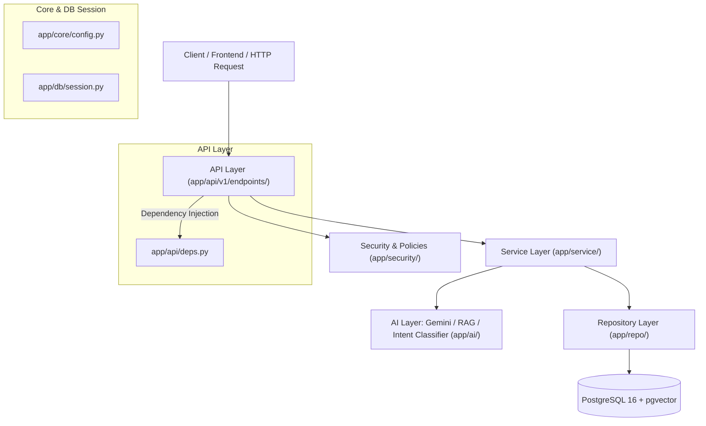
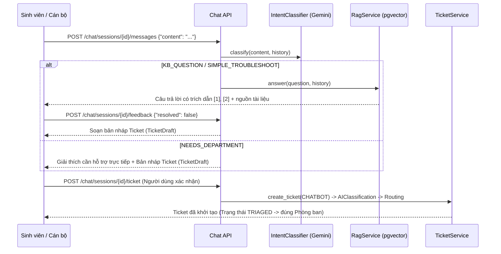

# Helpdesk AI - Backend Service

Dịch vụ Backend cho hệ thống **Helpdesk AI**, được xây dựng bằng **FastAPI**, **PostgreSQL 16 (pgvector)**, **Google Gemini 3.5**, **SQLAlchemy 2.0 (Async)** và **Pydantic v2**.

Dự án được tổ chức theo kiến trúc phân tầng chuyên biệt (**3-Tier Architecture**: *Endpoints - Services - Repositories*) nhằm đảm bảo phân tách rõ ràng trách nhiệm, dễ bảo trì, dễ mở rộng và kiểm thử tự động toàn diện.

---

## 1. Kiến trúc phân tầng (3-Tier Architecture)



### Luồng xử lý câu hỏi & tạo Ticket:



---

## 2. Cấu trúc thư mục chi tiết

```text
backend/
├── alembic/                    # Database migration (Asyncpg + SQLAlchemy + pgvector)
│   ├── versions/               # Lịch sử các migration
│   └── env.py                  # Cấu hình kết nối và metadata cho Alembic
├── app/
│   ├── ai/                     # Lớp xử lý AI & RAG
│   │   ├── chunking.py         # Tách đoạn văn bản (800 ký tự, 150 overlap)
│   │   ├── extractors.py       # Trích xuất văn bản từ .txt, .md, .pdf, .docx
│   │   ├── gemini_client.py    # Google Gemini Client (gemini-3.5-flash-lite, gemini-embedding-001)
│   │   ├── fake_client.py      # Giả lập offline không gọi mạng phục vụ test tự động
│   │   ├── prompts.py          # Hệ thống Prompt tiếng Việt (Intent, RAG, Ticket Draft)
│   │   └── schemas.py          # Pydantic schemas cho structured LLM output
│   ├── api/
│   │   ├── deps.py             # FastAPI Dependencies (SessionDep, Service injection, LLMClient)
│   │   └── v1/
│   │       ├── router.py       # Gom nhóm toàn bộ router v1
│   │       └── endpoints/      # API Endpoints
│   │           ├── auth.py         # Đăng ký, đăng nhập, đổi mật khẩu, xem profile
│   │           ├── categories.py   # CRUD danh mục sự cố / thủ tục (Category)
│   │           ├── chat.py         # Chatbot hỏi đáp, RAG, đánh giá, xác nhận tạo ticket
│   │           ├── departments.py  # Tạo và xem thông tin phòng ban, thành viên
│   │           ├── health.py       # Kiểm tra kết nối database và extension pgvector
│   │           ├── knowledge.py    # Upload tài liệu (.txt, .md, .pdf, .docx), embedding, publish
│   │           ├── tickets.py      # Tạo phiếu hỗ trợ (Web form), danh sách theo vai trò
│   │           └── users.py        # Quản lý người dùng, phân quyền
│   ├── core/
│   │   ├── config.py           # Quản lý cấu hình Settings tự động đọc file .env
│   │   └── security.py         # Mã hóa mật khẩu Argon2id, JWT token (encode/decode)
│   ├── db/
│   │   ├── base.py             # DeclarativeBase và TimestampMixin
│   │   └── session.py          # Khởi tạo AsyncEngine, AsyncSessionLocal, dependency get_db
│   ├── models/                 # ORM Models (SQLAlchemy 2.0)
│   │   ├── category.py         # Bảng category
│   │   ├── chat.py             # Bảng chat_session, chat_message, message_source
│   │   ├── department.py       # Bảng department
│   │   ├── enums.py            # UserRole, TicketStatus, Priority, Channel, Intent
│   │   ├── knowledge.py        # Bảng knowledge_document, knowledge_chunk (pgvector 768)
│   │   ├── ticket.py           # Bảng ticket, ticket_history, ticket_comment, ai_classification
│   │   └── user.py             # Bảng app_user
│   ├── repo/                   # Repositories (Data Access Layer)
│   ├── schemas/                # Pydantic Request & Response Schemas
│   ├── security/               # Phân quyền ma trận vai trò (policies.py, deps.py)
│   ├── service/                # Business Logic Services
│   │   ├── category.py         # CategoryService
│   │   ├── chat.py             # ChatService
│   │   ├── classifier.py       # IntentClassifier, ClassifierService, RoutingService
│   │   ├── knowledge.py        # KnowledgeService
│   │   ├── rag.py              # RagService
│   │   └── ticket.py           # TicketService
│   └── cli.py                  # Công cụ dòng lệnh CLI
├── scripts/
│   ├── init-db.sql             # Kích hoạt extension pgvector và uuid-ossp
│   ├── seed_data.py            # Khởi tạo phòng ban, danh mục, tài liệu tri thức mẫu
│   └── evaluate_flow.py        # Kịch bản đánh giá độ chính xác phân loại ý định
└── tests/                      # Bộ kiểm thử tự động (77 test cases)
```

---

## 3. Danh sách API Endpoints (`/api/v1`)

### 3.1. Chatbot & RAG (`/chat`)
| Phương thức | Đường dẫn | Quyền hạn | Mô tả |
| :--- | :--- | :--- | :--- |
| `POST` | `/api/v1/chat/sessions` | Đã đăng nhập | Bắt đầu một phiên trò chuyện mới. |
| `GET` | `/api/v1/chat/sessions` | Đã đăng nhập | Lịch sử các phiên chat của tôi (ADMIN xem được tất cả). |
| `GET` | `/api/v1/chat/sessions/{id}` | Chủ phiên / ADMIN | Xem chi tiết phiên chat kèm lịch sử tin nhắn & nguồn trích dẫn. |
| `POST` | `/api/v1/chat/sessions/{id}/messages` | Chủ phiên | Gửi câu hỏi: Hệ thống tự động phân loại ý định, chạy RAG hoặc đề xuất bản nháp Ticket. |
| `POST` | `/api/v1/chat/sessions/{id}/feedback` | Chủ phiên | Đánh giá câu trả lời (Đã giải quyết / Chưa). Nếu chưa, bot tạo ngay bản nháp Ticket. |
| `POST` | `/api/v1/chat/sessions/{id}/ticket` | Chủ phiên | **Xác nhận** tạo Ticket chính thức từ phiên chat (idempotent, không bị trùng). |

### 3.2. Phiếu hỗ trợ (`/tickets`)
| Phương thức | Đường dẫn | Quyền hạn | Mô tả |
| :--- | :--- | :--- | :--- |
| `POST` | `/api/v1/tickets` | `can_create_ticket` | Tạo ticket qua web form: AI tự động phân loại và định tuyến tới phòng ban. |
| `GET` | `/api/v1/tickets` | `can_view_ticket` | Danh sách ticket theo vai trò (Sinh viên xem của mình; Kỹ thuật viên xem của phòng ban; Admin xem tất cả). |
| `GET` | `/api/v1/tickets/{id}` | `can_view_ticket` | Xem chi tiết ticket, lịch sử trạng thái (timeline) và phân loại AI. |

### 3.3. Quản lý kho tri thức (`/knowledge`)
| Phương thức | Đường dẫn | Quyền hạn | Mô tả |
| :--- | :--- | :--- | :--- |
| `GET` | `/api/v1/knowledge` | `ADMIN` | Xem danh sách tài liệu tri thức (lọc theo danh mục, trạng thái). |
| `GET` | `/api/v1/knowledge/{id}` | `ADMIN` | Xem chi tiết tài liệu tri thức. |
| `POST` | `/api/v1/knowledge` | `ADMIN` | Thêm tài liệu văn bản trực tiếp (tự động chunking và sinh vector embedding). |
| `POST` | `/api/v1/knowledge/upload` | `ADMIN` | Tải lên tài liệu (.txt, .md, .pdf, .docx), tự động trích xuất nội dung và sinh vector. |
| `PATCH` | `/api/v1/knowledge/{id}` | `ADMIN` | Cập nhật tiêu đề, nội dung, danh mục. |
| `DELETE` | `/api/v1/knowledge/{id}` | `ADMIN` | Xóa tài liệu và toàn bộ các vector chunk liên quan. |
| `POST` | `/api/v1/knowledge/{id}/publish` | `ADMIN` | Xuất bản tài liệu để Chatbot RAG sử dụng. |
| `POST` | `/api/v1/knowledge/{id}/unpublish` | `ADMIN` | Gỡ xuất bản tài liệu. |

### 3.4. Quản lý danh mục (`/categories`)
| Phương thức | Đường dẫn | Quyền hạn | Mô tả |
| :--- | :--- | :--- | :--- |
| `GET` | `/api/v1/categories` | Đã đăng nhập | Xem danh mục hỗ trợ (lọc theo phòng ban, trạng thái hoạt động). |
| `POST` | `/api/v1/categories` | `ADMIN` | Tạo mới danh mục, liên kết phòng ban và cấu hình SLA. |
| `PATCH` | `/api/v1/categories/{id}` | `ADMIN` | Cập nhật thông tin danh mục. |
| `DELETE` | `/api/v1/categories/{id}` | `ADMIN` | Xóa danh mục (nếu chưa có ticket/tài liệu liên kết). |

---

## 4. Công cụ dòng lệnh CLI (`app/cli.py`)

```powershell
# 1. Tạo tài khoản Admin ban đầu
python app/cli.py create-admin

# 2. Khởi tạo dữ liệu mẫu (Phòng ban, Danh mục, Tài liệu tri thức FAQ + Embeddings)
python app/cli.py seed-data

# 3. Chạy đánh giá độ chính xác phân loại ý định
python scripts/evaluate_flow.py
```

---

## 5. Hướng dẫn kiểm thử tự động (Pytest)

Toàn bộ **77 test case** chạy độc lập, offline không phụ thuộc API key ngoài nhờ `FakeLLMClient`:

```powershell
.\.venv\Scripts\pytest -v
```
